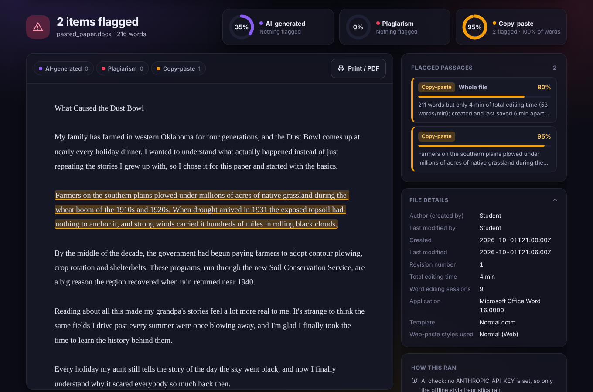

# That's A Flag (web version)

A web app, ready to host on Vercel, that checks an undergraduate paper for passages that look
**AI-generated**, **plagiarized**, or **copy-pasted**, and flags anything above **50% confidence**.
It builds on the desktop proof of concept in [`desktop/`](desktop/), adding three things:

| Check | Desktop version | Web version |
|---|---|---|
| AI-generated | Style heuristics (optional local GPT-2) | **Claude reads every passage** and gives a probability with the signals it used, blended 75/25 with the style heuristics |
| Plagiarism | Only against files in a local folder | **Searches the web** for the paper's most distinctive sentences, downloads the pages, and matches them word for word and by close paraphrase. Uploaded reference files still work too |
| Copy-paste | Fonts, colours, odd characters | Adds **.docx metadata and paste traces** (details below) |



> These are signals worth a closer look, never proof. AI detection in particular is unreliable,
> and the metadata signals have innocent explanations (see below). Talk with the student before
> drawing conclusions.

## What it costs and what you need

| Piece | Account / key | Cost |
|---|---|---|
| Hosting | Free [Vercel](https://vercel.com) Hobby account, linked to a GitHub repo | Free for personal, non-commercial use. A school or paid deployment needs Vercel Pro ($20/month per member) |
| AI check + web search | [Anthropic API key](https://console.anthropic.com/settings/keys) (`ANTHROPIC_API_KEY`). The account needs prepaid credit (from $5) | Pay per use, see the estimate below |
| Everything else (copy-paste, metadata, matching) | none | Free, runs in the app |

**Rough cost per paper (about 2,500 words, default model `claude-opus-5-5`):**

- AI check: about 4k tokens in and a few thousand out, roughly **$0.05 to $0.10**.
- Web search: 8 searches at Anthropic's web-search fee (about $10 per 1,000 searches, so **$0.08**),
  plus the search results Claude reads, roughly **$0.10 to $0.25** more.
- **Total: roughly $0.25 to $0.45 per paper.** Set `CLAUDE_MODEL=claude-haiku-5-5` to cut that to
  around **$0.10** (mostly the search fee), at some cost in judgment.

These are estimates; check the live prices at <https://www.anthropic.com/pricing> and watch actual
spend in the Anthropic console. You can set a monthly spend limit there.

**Privacy:** with Claude turned on, the paper's text goes to Anthropic's API, and short phrases
from it go into web searches. Check your school's rules on sharing student work before using real papers.

## Run it on your computer

1. Install [Node.js 20 or newer](https://nodejs.org).
2. In this folder:

   ```
   npm install
   cp .env.example .env.local      # then put your key in .env.local
   npm run dev
   ```

3. Open <http://localhost:3000>. Try `tests/fixtures/mixed_paper.docx` (flags all three categories)
   and `tests/fixtures/pasted_paper.docx` (flags the metadata traces).

Without an API key the app still runs: you get the style heuristics, reference-file matching and
all the copy-paste checks, but no Claude reading and no web search.

## Put it on Vercel

1. Create a GitHub repository and push this folder to it.
2. On Vercel: **Add New → Project → import that repository**. It detects Next.js; keep the defaults.
3. Under **Settings → Environment Variables** add:
   - `ANTHROPIC_API_KEY`: your key
   - `APP_PASSWORD`: any password. **Do this.** Without it anyone who finds the URL can spend your API credit.
   - `CLAUDE_MODEL` (optional): e.g. `claude-haiku-5-5`
4. Deploy. The analysis route is allowed up to 300 seconds, since web search and page downloads can take a minute or two.

## How each check works

### AI-generated
Claude reads the paper's passages in order and returns, for each one, a probability and the
signals behind it (generic phrasing, stock transitions, no specific detail, a sudden change in
voice, versus personal detail, natural errors, a consistent student voice). The prompt tells it
to be conservative and that formal writing or non-native English is not evidence of AI
(`lib/claude.ts`). The final score is 75% Claude, 25% the offline style heuristics.

### Plagiarism
1. Picks up to 8 long, specific, unquoted sentences spread across the paper (`pickSearchSentences` in `lib/analyze.ts`).
2. Claude runs one web search per sentence; the app keeps the result URLs.
3. The app downloads up to 25 of those pages itself and compares them with the paper:
   runs of 8+ identical words, and sentences that share most of their key words with a page sentence.
4. A flag always comes from text that actually matches, with a link to the page. Text inside quotation marks gets half confidence.

Limits: paywalled pages, PDFs and sites that block downloads can't be compared (they're listed as
"couldn't download"), and search only covers what's publicly indexed.

### Copy-paste
Per passage:
- formatting that doesn't match the rest of the paper (font, size, colour, highlight, hyperlinks)
- a **language tag** that differs from the rest (text pasted from a page set to en-GB inside an en-US paper)
- **web-paste styles** Word creates when pasting from a browser, such as "Normal (Web)"
- **hidden text**
- a paragraph added in a **single Word editing session** that changed nothing else (from Word's revision-session ids)
- odd characters and web/PDF leftovers: non-breaking or zero-width spaces, `[12]`, `[citation needed]`, URLs, mid-sentence line breaks

For the whole file (shown under **File metadata**):
- **total editing time** far too short for the length (for example 2,000 words in 6 minutes)
- created and last saved only minutes apart
- very few saved revisions or editing sessions for a long paper
- **embedded HTML/RTF chunks** (`altChunk`), which Word inserts for some pasted or inserted content
- author / last-modified-by, application and template, shown for context

The editing-time signals are only used for files saved by Microsoft Word. They also fire when a
student drafts in Google Docs or another app and pastes the finished paper into Word, so the
reason text says so and the whole-file score is capped at 80%. A plain-text paste ("keep text
only") leaves almost none of these traces.

## Project layout

```
app/page.tsx              upload form and results page
app/api/analyze/route.ts  receives the upload, runs the checks
app/api/config/route.ts   tells the page whether a key/password is configured
lib/analyze.ts            runs everything and builds the report
lib/claude.ts             the two Claude calls (AI scoring, web search)
lib/web.ts                downloads search-result pages safely, HTML to text
lib/plagiarism.ts         verbatim and paraphrase matching
lib/copyPaste.ts          per-passage and whole-file copy-paste signals
lib/docx.ts               reads .docx text, formatting and metadata
lib/aiHeuristics.ts       offline style heuristics
tests/                    npm test (13 tests; Claude and the web are stubbed)
```

## Testing status

- `npm test`: 13 tests pass, covering the .docx reader, all three checks, the metadata traces,
  and the Claude-backed paths with Claude and the web stubbed out.
- `npm run build` succeeds, and the page was checked in a browser against the sample papers.
- **Not yet tested with a real API key.** The requests type-check against the official Anthropic
  SDK and reach the API (a fake key gets the expected "unauthorized"), but the first real run is
  yours. If something fails, the page shows which check failed and falls back to the offline checks.
