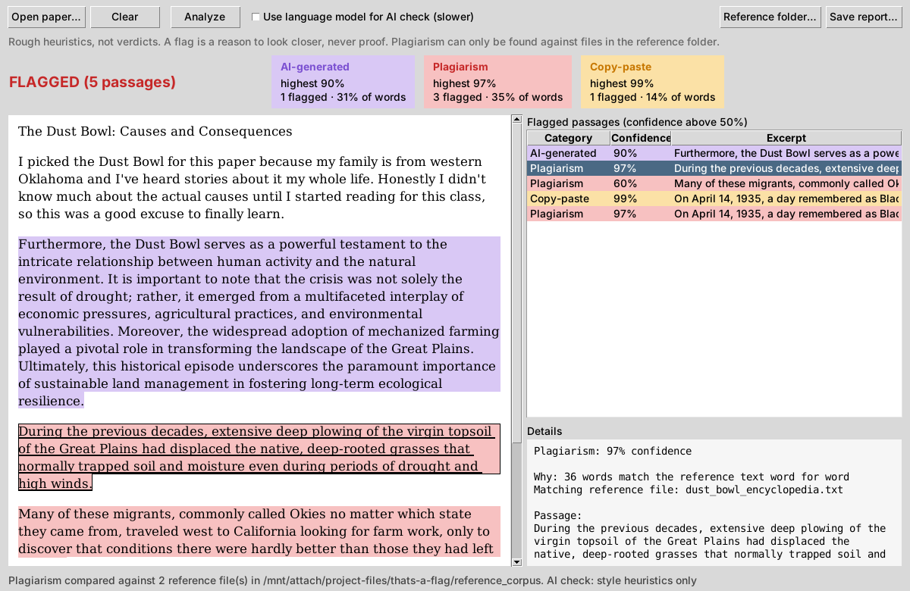

# That's A Flag (proof of concept)

A desktop app that reads an undergraduate paper and highlights passages that look
**AI-generated**, **plagiarized**, or **copy-pasted** from somewhere else. Any passage
where the confidence in a category is **above 50%** is flagged, highlighted in the
paper, and listed with the reason.

Everything runs on your own computer with free tools. Nothing is uploaded anywhere.

Highlight colours: purple = AI-generated, red = plagiarism, orange = copy-paste.



> **Read this first.** These checks are rough heuristics, not verdicts. AI detectors in
> particular are often wrong, especially on short passages, very formal writing, and
> writing by non-native English speakers. Treat a flag as a reason to look closer and
> talk to the student, never as proof.


## Install

1. Install **Python 3.10 or newer** from <https://www.python.org/downloads/>.
   On Windows, tick **"Add python.exe to PATH"** in the installer. The python.org
   installers include Tkinter, which the window uses. (On Linux you may need
   `sudo apt install python3-tk`.)
2. Copy the `thats-a-flag` folder to your computer and open a terminal in it.
3. Install the one required library:

   ```
   python -m pip install -r requirements.txt
   ```

   (On macOS/Linux use `python3` instead of `python` everywhere in this file.)

### Optional: the language-model AI check

The AI check works out of the box with style heuristics. For a stronger signal you can
add a small local language model (distilGPT-2) that measures how predictable the
writing is:

```
python -m pip install -r requirements-ai-model.txt
```

Then tick **"Use language model for AI check"** in the app. The first run downloads the
model (about 350 MB) from Hugging Face; after that it works offline.

## Run

```
python app.py
```

1. Click **Open paper…** and choose a `.docx`, `.txt` or `.md` file, or paste text into the left pane.
2. Click **Analyze**.
3. Flagged passages are highlighted. Click one in the list (or in the paper) to see why.
4. **Save report…** writes an HTML (or plain-text) report you can keep or share.

Try it on the included samples: `samples/mixed_paper.docx` (should flag all three
categories) and `samples/honest_paper.txt` (should flag nothing).

There is also a command-line version:

```
python check.py samples/mixed_paper.docx --html report.html
```

## How each check works

| Category | What it looks at | Limits |
|---|---|---|
| **AI-generated** | Per paragraph: how uniform sentence lengths are, stock chatbot phrases ("delve", "it is important to note", "plays a pivotal role"...), word length, no contractions or first person. With the optional model, also perplexity (how predictable the text is). | Easy to fool by light editing; formal human writing can score high. Heuristics alone are capped at 90%. The model's scale (`PPL_MIDPOINT` in `flagger/ai_detector.py`) is an untested guess and should be tuned on real papers. |
| **Plagiarism** | Compares the paper with every file in the **reference folder**: runs of 8+ identical words (verbatim), and sentences that share most of their key words with a reference sentence (close paraphrase). Text inside quotation marks gets half the confidence. | Only finds sources you put in the reference folder. There is no internet search. |
| **Copy-paste** | Traces of pasting even when the source is unknown: in `.docx` files, a different font, size or colour from the rest of the paper, highlighting, hyperlinks; in any file, non-breaking or zero-width spaces, `[12]` reference numbers, `[citation needed]`, URLs, hard line breaks mid-sentence, a different quote style. | Formatting checks need a `.docx`. A careful student who pastes as plain text leaves few traces. |

### The reference folder

`reference_corpus/` ships with two short example sources. Add the readings, articles,
textbook chapters, or past papers you want to compare against (`.txt`, `.md`,
`.docx`), or point the app at another folder with **Reference folder…**.

## Project layout

```
app.py                  desktop window (Tkinter)
check.py                command-line version
flagger/
  document.py           loads .docx/.txt and keeps formatting + character positions
  ai_detector.py        AI-likelihood heuristics and optional language model
  plagiarism.py         verbatim + paraphrase matching against the reference folder
  copy_paste.py         formatting and character traces of pasting
  engine.py             runs all checks, builds the report (50% threshold in report.py)
  export.py             HTML / text reports
reference_corpus/       sources to compare against
samples/                demo papers (rebuild with python samples/make_samples.py)
tests/                  python -m unittest discover tests
```

## Ideas for next steps

- Calibrate the AI scores on a set of known human and known AI papers.
- Swap distilGPT-2 for a stronger local model, or a dedicated open-source detector.
- Add web search for plagiarism (would need an API and break "local only").
- Package as a single `.exe` / `.app` with PyInstaller.
